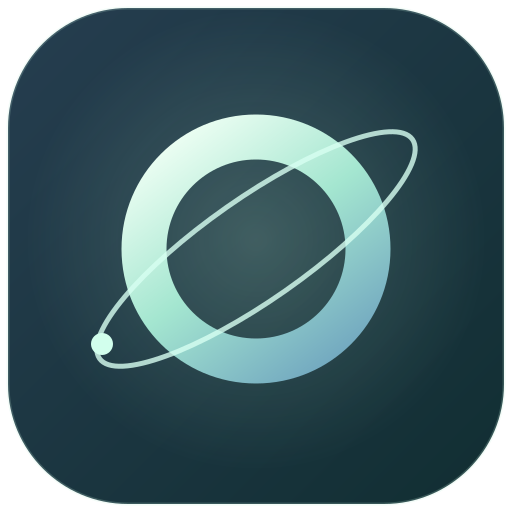
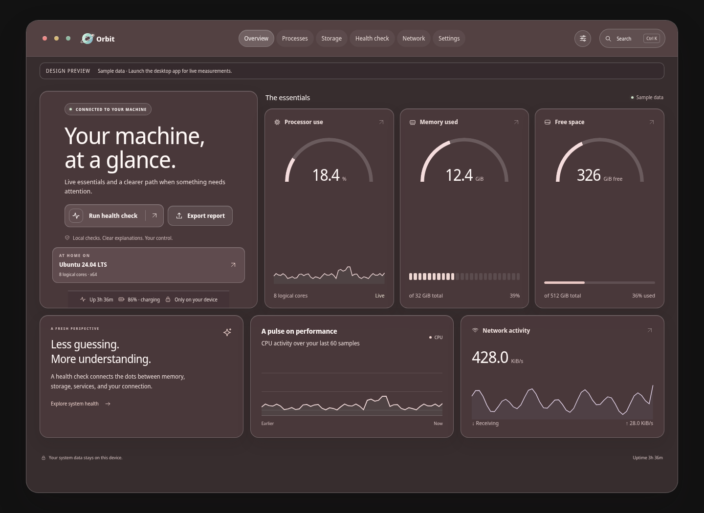

<p align="center"></p>
<h1 align="center">Orbit</h1>
<p align="center"><strong>Your machine, understood.</strong><br>A local desktop control center for Linux and Windows, in a translucent window.</p>
<p align="center">Live performance · Processes · Storage inspection · Explainable health checks</p>



Orbit brings the everyday questions together: **What is using my memory? Where did my disk space go? Is something wrong?** The first release combines real system measurements with a calm, animated interface. No account, cloud service, or subscription.

## What works today

- **Overview:** measured CPU, memory, and storage gauges; network throughput; uptime, battery status, host OS identity, and a rolling 60-sample CPU graph.
- **Processes:** live OS process list, name/PID filtering, CPU/memory/name sorting, and process states. Up to 400 entries; no process termination.
- **Storage:** mounted filesystem usage plus a native folder picker and a bounded recursive size inspection. Never follows symlinks, crosses filesystem boundaries, or deletes files; hard links count once.
- **Health:** measured CPU, memory, disk, interface, Linux systemd, and battery checks with evidence and next steps. Unsupported checks remain explicitly unknown.
- **Reports:** local JSON exports omit hostnames, usernames, IP addresses, paths, process names, and service names. Exports include hardware model and OS information; review before sharing.
- **Interface:** one warm, translucent dashboard appearance, a live transparency slider saved on this device, keyboard-accessible dropdowns, command palette, adjustable polling, quiet-motion mode, and responsive layouts.
- **Machine details:** distribution and version, codename, kernel, architecture, processor, logical cores, desktop, and session where reported. Open the device card or Preferences to inspect them. Flatpak shows the host OS separately from its runtime.

The frameless Electron window lets the actual desktop show through its clear corners and translucent panels. Use the slider in the top bar or Preferences to set transparency from 0% to 80%. There is no wallpaper or theme picker inside the app. Health-check actions show an explicit scanning state.

## Run from source

Requires Node.js 22.12+ and a graphical desktop.

```bash
npm ci
npm start
```

`npm run preview` serves the interface on `http://127.0.0.1:4173`. **Browser preview uses clearly labelled sample data.** Only the Electron desktop app measures your computer. All fonts, icons, scripts, and styles ship locally.

## Packages

Build outputs go to `release/`.

| Format | Build command | Notes |
| --- | --- | --- |
| Debian / Ubuntu `.deb` | `npm run build:linux` | x64; full user-visible host diagnostics |
| Linux `.AppImage` | `npm run build:linux` | x64; may require the distribution’s FUSE support |
| Windows portable `.exe` | `npm run build:windows` | x64; self-extracting, unsigned |
| Windows setup `.exe` | `npm run build:windows:installer` | Build on Windows, or Linux with Wine installed |
| Flatpak `.flatpak` | `npm run build:flatpak` | x64; requires Flatpak and the Platform/Electron base |

For example, from the release directory:

```bash
sudo apt install ./Orbit-0.1.0-linux-amd64.deb
# or
chmod +x Orbit-0.1.0-linux-x86_64.AppImage
./Orbit-0.1.0-linux-x86_64.AppImage
# or, once the matching runtime is available
flatpak install --user ./Orbit-0.1.0-linux-x86_64.flatpak
flatpak run io.github.orbitdesktop.Orbit
```

Windows users can launch the portable executable directly. The current Windows build includes the translucent dashboard and transparency slider, and is unsigned. Linux-to-Windows cross-building does not validate Windows runtime behavior; test it on Windows before publishing a release.

The GitHub Actions workflow builds Linux, Windows portable/setup, and Flatpak artifacts. It uploads build artifacts rather than publishing releases. Before publishing packages, replace the placeholder maintainer address in `package.json`, choose an application ID tied to your own project, and configure signing if desired. This app is not yet published to Flathub.

### Flatpak’s scope

The Flatpak declares read-only home access for storage inspection, display/GPU access, IPC, and network namespace access for passive interface measurements. File exports use the native dialog/portal. Host service checks are unavailable; the process list and other measurements may reflect the sandbox. Orbit displays this limitation in the app and in reports. The host distribution is read from Flatpak’s read-only `/run/host/os-release`, as documented in the [Flatpak command reference](https://docs.flatpak.org/en/latest/flatpak-command-reference.html); unavailable host identity is labelled rather than replaced with the runtime name. It does not request host command execution. Use `.deb` or AppImage for broader host visibility.

Build requirements: `flatpak`, Freedesktop Platform 25.08, and `org.electronjs.Electron2.BaseApp` 25.08. The bundle script packages the precompiled Electron app using standard `flatpak build-init`, `build-finish`, `build-export`, and `build-bundle` commands. The Platform is also the build environment; no SDK compiler or Flatpak Builder is needed. It uses the base app’s Zypak wrapper to preserve renderer isolation.

```bash
flatpak remote-add --user --if-not-exists flathub https://dl.flathub.org/repo/flathub.flatpakrepo
flatpak install --user --noninteractive flathub org.freedesktop.Platform//25.08 org.electronjs.Electron2.BaseApp//25.08
npm run build:flatpak
```

If `release/linux-unpacked` is already current, `npm run bundle:flatpak` skips repackaging Electron. Bundle creation does not update installed system runtimes. Each build uses a fresh directory under `release/flatpak-build-*`, retained for inspection.

## Keyboard

| Shortcut | Action |
| --- | --- |
| Ctrl/Cmd K | Open command palette |
| Alt 1–5 | Switch primary view |
| ↑ / ↓, Enter | Navigate palette / run selected command |
| Esc | Close palette |

## Performance and measurement

Polling defaults to two seconds, can be changed to five or ten seconds, and pauses when the app is hidden. Disk/interface metadata refreshes every 30 seconds. Process queries are cached for four seconds and requested while viewing Processes. Polls do not overlap. The dashboard uses CSS panels and charts; quiet-motion and transparency controls remain available.

Folder scans stop after 15 seconds or 60,000 directory entries and return labelled partial results. Counts are logical file sizes, not allocated blocks. Inaccessible entries, symlinks, and mount crossings are skipped. Results can change while other apps edit files. Network checks inspect adapters, not external internet reachability. Health checks are diagnostic snapshots, not predictions or a security audit.

## Development and checks

```bash
npm run check
npm test
npx playwright install chromium
npm run test:ui
npm run test:desktop
```

For an existing test browser, set `ORBIT_BROWSER_PATH` to its executable before `npm run test:ui`. The desktop integration test needs a display. It exercises live measurements, process enumeration, native dialog bridges, a temporary folder scan, JSON export, and renderer isolation. Test dialogs select only temporary fixtures; no user files are changed. Screenshots are written to ignored `test-results/`.

| Path | Responsibility |
| --- | --- |
| `desktop/main.cjs` | Window lifecycle, validated IPC, native dialogs |
| `desktop/preload.cjs` | Narrow renderer API; no general shell or filesystem access |
| `desktop/metrics.cjs` | Cross-platform measurements, health rules, report allowlist |
| `desktop/storage.cjs` | Bounded folder traversal |
| `desktop/system-info.cjs` | Native / Flatpak host identity and safe os-release parsing |
| `ui/` | Offline interface, charts, one translucent appearance, glass select controls, command palette |
| `scripts/` | Preview and integration checks |
| `test/` | Diagnostic, privacy, and filesystem behavior tests |

Electron runs with context isolation, a sandboxed renderer, Node integration disabled, a restrictive content security policy, blocked navigation, and fixed IPC handlers. See [Electron’s security guidance](https://www.electronjs.org/docs/latest/tutorial/security/) and [Electron Builder’s packaging documentation](https://www.electron.build/).

## Contributing

See [CONTRIBUTING.md](CONTRIBUTING.md) and the [validation record](docs/VALIDATION.md). Useful next contributions include Windows runtime testing, distribution-specific collectors, accessibility reviews, localization, and improved host visibility documentation. Please keep unavailable data honest and system-changing operations out of the read-only diagnostic path.

## License

MIT. Built with Electron and systeminformation. The diagnostic approach grows from the local Linux Doctor project; Orbit is a separate implementation.
